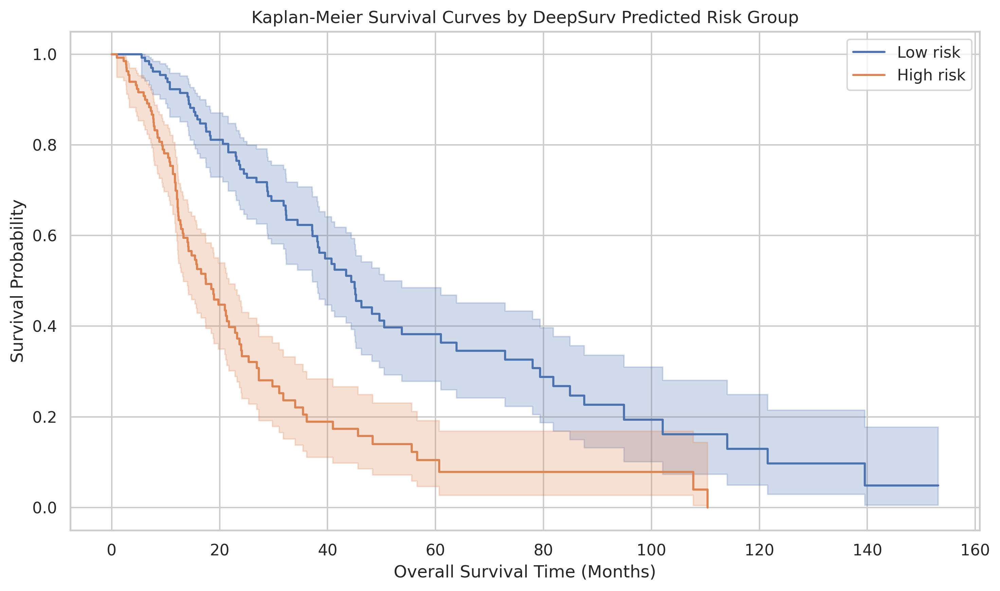
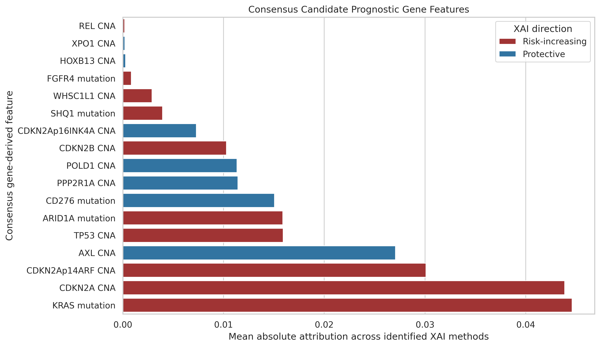
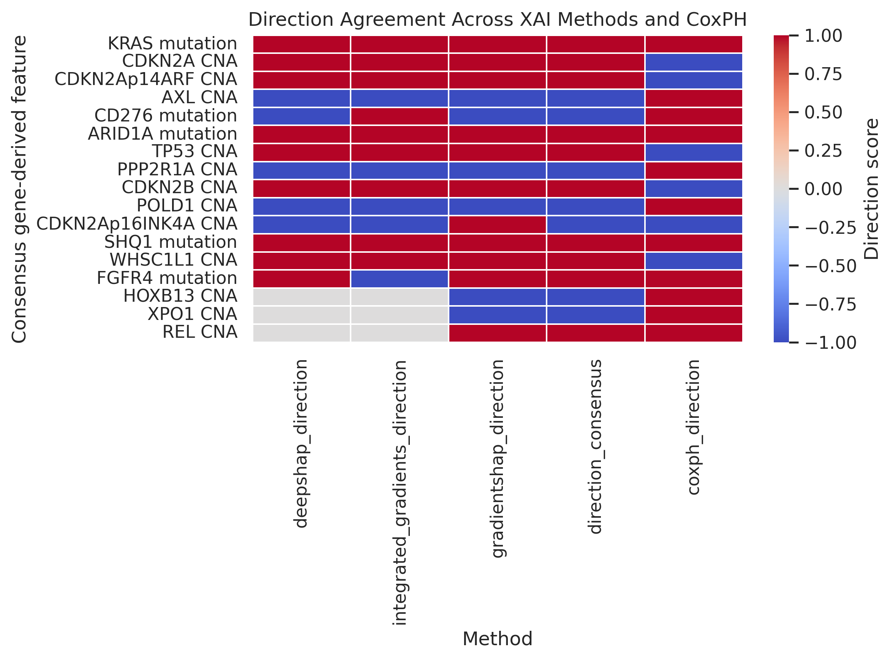

# Explainable Survival Prediction and Biomarker Discovery in Hepatocellular Carcinoma

Code for our paper at the **2026 IEEE Biomedical Engineering International Conference (BMEiCON-2026)**.

This project predicts overall survival for 1,357 patients with hepatocellular carcinoma (HCC) using clinical, tumour, mutation and copy-number data. It then asks *which genes drive the prediction*. Three explainability methods are run on a DeepSurv model, and their answers are combined into one consensus ranking of candidate prognostic biomarkers.

---

## Results

Test set: 272 patients, held out before any preprocessing.

| Feature selection | Model | C-index | IBS ↓ | AUC 1 yr | AUC 3 yr | AUC 5 yr | Mean AUC |
|---|---|---|---|---|---|---|---|
| **Univariate Cox + FDR** (paper) | CoxPH | **0.725** | 0.130 | 0.798 | 0.809 | 0.753 | 0.793 |
| **Univariate Cox + FDR** (paper) | DeepSurv | **0.722** | 0.141 | 0.802 | 0.802 | 0.803 | 0.802 |
| SelectKBest top 50 | CoxPH | 0.740 | 0.119 | 0.815 | 0.838 | 0.807 | 0.825 |
| SelectKBest top 50 | DeepSurv | 0.729 | 0.129 | 0.789 | 0.838 | 0.829 | 0.824 |
| Baseline (exp_1) | CoxPH | 0.735 | 0.122 | 0.806 | 0.839 | 0.797 | 0.821 |
| Baseline (exp_1) | DeepSurv | 0.739 | 0.131 | 0.814 | 0.838 | 0.785 | 0.819 |

In every run, the high-risk and low-risk groups separate clearly (log-rank p < 1e-10).

**Why the paper uses the Univariate Cox branch even though it doesn't score highest:** its features are chosen by their own association with survival (one Cox model per feature, then Benjamini–Hochberg FDR correction). That makes the selected genes meaningful as biomarkers, which is the goal of the study. The SelectKBest branches rank features against the event flag alone and ignore survival time.

**Consensus biomarkers:** DeepLiftShap, Integrated Gradients and GradientSHAP agree on 17 features (15 unique genomic loci). The strongest are **KRAS mutation, CDKN2A CNA and CDKN2A-p14ARF CNA**. **ARID1A, TP53 and AXL** also contribute consistently. Several of these have independent support in the published HCC literature (see the paper).

| Kaplan–Meier by predicted risk (DeepSurv) | Consensus gene ranking |
|---|---|
|  |  |



---

## Data

The [HCC MSK 2024 cohort](https://www.cbioportal.org/study/summary?id=hcc_msk_2024) from cBioPortal: clinical patient and sample tables, somatic mutations, and copy-number alterations. It's public, but not redistributed here. Download the study files (`data_clinical_patient.txt`, `data_clinical_sample.txt`, `data_mutations.txt`, `data_cna.txt`) and place them in a `Data/hcc_msk_2024/` folder.

After merging and cleaning: 1,357 patients, 1,192 predictors, and an 80/20 split stratified on the survival event.

---

## Pipeline

Each notebook is one step and reads the files saved by the step before it.

| Step | Notebook | What it does |
|---|---|---|
| 1 | `Code/Step1_Hepatocellular_Carcinoma_preprocessing.ipynb` | Merge clinical, mutation and CNA tables; build the survival label; split; fit imputation and encoding on the training set only |
| 2 | `step_2_*_feature_engineering` | Feature selection: Univariate Cox + FDR, SelectKBest, or the baseline |
| 3 | `step_3_*_training` | Penalized CoxPH with a cross-validated grid search |
| 4 | `step_4_*_model_evaluation` | C-index, IBS, time-dependent AUC, Kaplan–Meier, log-rank |
| 5 | `step_5_*_deep_surv_training` | DeepSurv hyperparameter search with 5-fold CV and early stopping |
| 6 | `step_6_*_Saving_best_model` | Retrain the best DeepSurv on the full training set |
| 7 | `step_7_*_Deep_surv_evaluation` | Same metrics as step 4, for DeepSurv |
| 8–10 | `Code/Explainable AI/` | CoxPH hazard ratios; DeepLiftShap, Integrated Gradients and GradientSHAP on DeepSurv; consensus gene ranking |

Steps 2–7 exist once per feature-selection experiment: `Code/UnivariateCox/`, `Code/SelectKBest50/`, `Code/exp_1/`.

Best DeepSurv (Univariate Cox branch): hidden layers [128, 64], dropout 0.2, batch size 128, ReLU, Adam, learning rate 0.005, weight decay 1e-4, early-stopping patience 20.

---

## How to run

The notebooks were written for **Google Colab** with the project folder on Google Drive.

1. Copy this repository into your Google Drive and add the data (see above).
2. Open each notebook in Colab. In its *paths* cell, change the `/content/drive/MyDrive/...` paths to your folder.
3. Run the steps in order: Step 1, then steps 2–7 for one experiment folder, then the `Explainable AI` notebooks.

All outputs (metrics, predictions, tuning logs, figures) are written to `Results/`. The copies in this repo are from the run reported in the paper.

Packages: see `requirements.txt`. Colab already has most of them; the notebooks install `lifelines` (and `torch`, `statsmodels` where needed) themselves.

---

## Limitations

- One cohort and one train/test split. External validation on an independent cohort is the next step.
- Numeric features enter CoxPH and DeepSurv without standardisation. The penalty and neural-network training are scale-sensitive, so a scaled re-run is planned for the journal extension.
- The consensus biomarkers are candidates. Functional validation (pathway and protein-interaction analysis) is future work.

---

## Citation

```
S. Thakur and S. Bhandari, "Explainable Survival Prediction and Biomarker Discovery
in Hepatocellular Carcinoma," in Proc. 2026 Biomedical Engineering International
Conference (BMEiCON-2026), IEEE, 2026.
```

For research use only; not for clinical decision-making.
